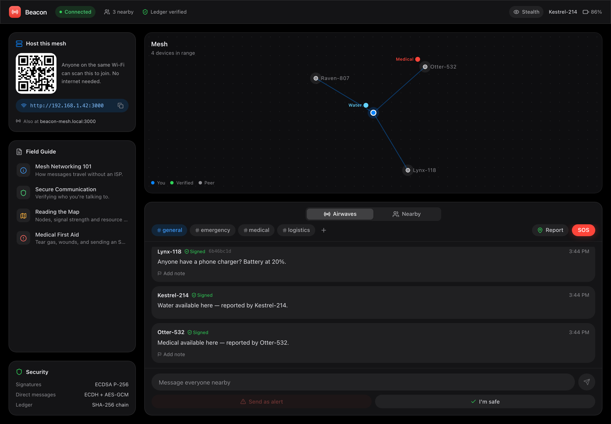
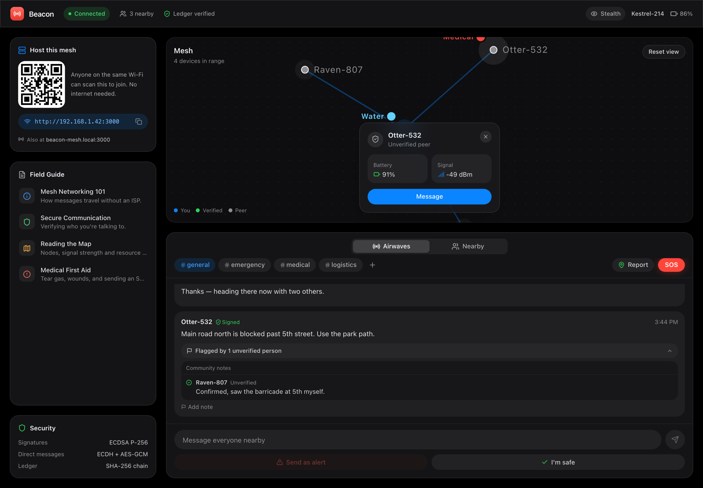
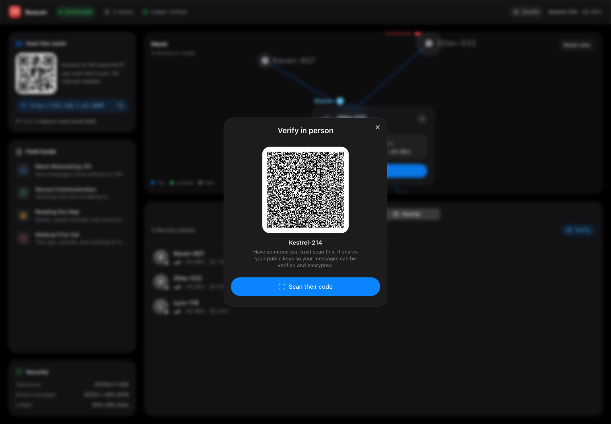
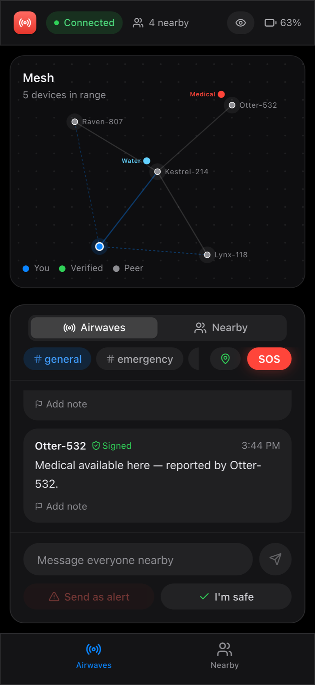

# Beacon

Messaging that keeps working when the internet doesn't.

Beacon is a local-first emergency messenger for protests, outages and disasters. One laptop hosts it on a Wi-Fi network or phone hotspot, everyone nearby opens it in a browser, and from there devices talk to each other directly. No accounts, no app store, no internet connection.

**[Landing page](https://anushka-naik.github.io/TMD-meshAlert/)**



## What it does

- **Channels and SOS.** Broadcast to `#general`, `#emergency`, `#medical`, `#logistics` or a channel you create. One tap sends a signed SOS.
- **Live mesh map.** See who's in range, signal strength, and water, food, medical or shelter points people have reported.
- **Direct messages.** Peer-to-peer over WebRTC when possible, end-to-end encrypted once you've verified each other.
- **Verify in person.** Scan someone's QR code to exchange public keys. Verified peers show up green.
- **Community notes.** Anyone can confirm or dispute a broadcast. Verdicts only count votes from verified people.
- **Works offline.** The app is a PWA, so once loaded it stays cached. Messages sent while disconnected are queued and synced on reconnect.

| Map detail | Verify in person | Mobile |
| --- | --- | --- |
|  |  |  |

## How it works

```
 host laptop (server.ts)                 phones / laptops on same Wi-Fi
 ┌──────────────────────────┐           ┌───────────┐     ┌───────────┐
 │ Express + Socket.io      │◄─signal──►│  browser  │◄───►│  browser  │
 │ serves app, relays       │           └───────────┘ P2P └───────────┘
 │ WebRTC offers, mDNS      │             WebRTC DataChannels (no server hop)
 └──────────────────────────┘
```

1. The host runs the server. It serves the app, advertises itself as `beacon-mesh.local` and shows a join QR code.
2. Peers join over the LAN. Socket.io is only used to exchange WebRTC offers and as a fallback relay.
3. Once DataChannels are open, messages go device-to-device. If the host drops, existing links keep working.

**Security, briefly**

| | |
| --- | --- |
| Message signing | ECDSA P-256 (Web Crypto) |
| Direct messages | ECDH-derived key wraps a per-message AES-GCM key |
| History | Each message hashes the previous one (SHA-256), so tampering breaks the chain and the toolbar flags it |
| Storage | Everything lives in the browser's `localStorage`; the server keeps no history |

This is a prototype. Peer locations on the map are simulated, and there has been no security audit.

## Run it

Requires Node 18+.

```bash
npm install
npm run dev
```

The server prints a local URL and your LAN addresses. Open the LAN address (or scan the QR in the app) on other devices connected to the same network.

```bash
npm run build                       # production bundle in dist/
NODE_ENV=production npx tsx server.ts
npx tsx stress-test.ts              # 10 simulated peers for 15s (server must be running)
```

## Stack

React 19, TypeScript, Vite, Tailwind CSS 4, Socket.io, WebRTC, Web Crypto, vite-plugin-pwa.

## Project layout

```
server.ts                  host server: static files, signaling, mDNS
src/lib/MeshContext.tsx    identity, crypto, ledger, sync
src/lib/webrtc-mesh.ts     peer-to-peer DataChannels
src/components/            map, channels, peers, notes, host panel
docs/                      landing page and screenshots
```
